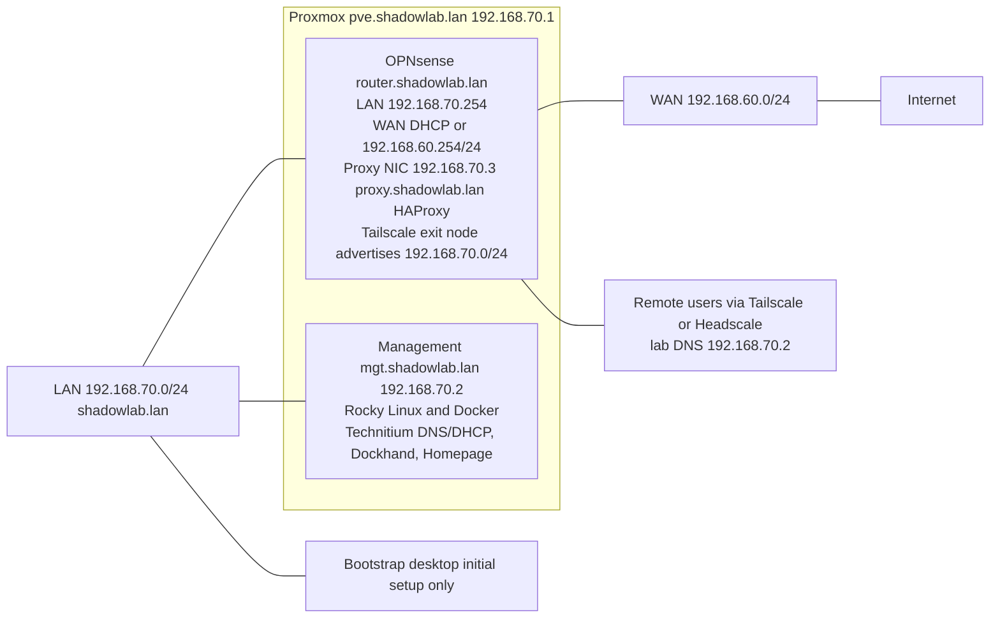

# Network diagram

Topology of the Shadow Lab: an isolated LAN, a WAN uplink, and remote access through Tailscale (or Headscale). Addresses and roles match [Network Settings](01_network.md).

The WAN prefix `192.168.60.0/24` is the example from the OPNsense setup and may differ per site.

